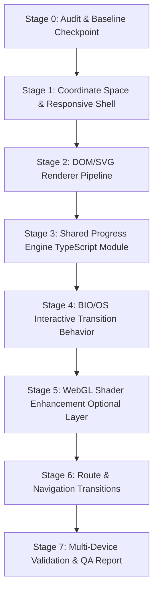

# FRESCO_ENGINE_PLAN.md — BIOS-Inspired Interactive Fresco Engine
**Project:** Mayank Kamdi Portfolio (`Mayank_Portfolio`)  
**Lead Engineer:** Senior Creative-Coding & Systems Architect  
**Date:** 2026-10-11  
**Status:** Stage 0 Complete — Audit & Technical Plan Approved  

---

## 1. Executive Summary & Objective

The goal is to architect and build an **original, high-performance interactive fresco hero experience** for Mayank Kamdi's portfolio, taking conceptual and interaction inspiration from [bios.notyouraverage.xyz](https://bios.notyouraverage.xyz/) while remaining fully original in branding, typography, and portfolio content.

### Core Architectural Principles
1. **No Fake Effects:** No pseudo-shaders or claims of WebGL until actual shaders are implemented and validated.
2. **Dual-Pipeline Architecture:** A complete, robust **DOM/SVG renderer** is built and verified first. WebGL is treated as a modular enhancement layer with zero regressions if disabled or unsupported.
3. **Deterministic Single-Source State:** A pure TypeScript module maps user input (scroll, pointer, touch) to a single signed progress scalar $p \in [-1, +1]$, deriving all geometric and optical transformations identically for both renderers.
4. **Baseline Preservation:** The existing GSAP-animated hero remains intact as a recoverable baseline under Git commit `6fa5414` and local branch `baseline-hero-v1`.
5. **Universal Accessibility:** Content remains fully accessible with JavaScript disabled, WebGL disabled, or under `prefers-reduced-motion: reduce`.

---

## 2. Current Architecture & Codebase State

### 2.1 Tech Stack & Dependencies (`package.json`)
- **Framework:** Next.js 14.2.15 (App Router, React 18.3.1, React-DOM 18.3.1)
- **Language:** TypeScript 5.6.3
- **Styling:** Vanilla CSS (`app/globals.css`), CSS custom properties
- **Animation/Motion:** `gsap: ^3.12.5` (currently used for entrance sequence and ScrollTrigger parallax in baseline hero)
- **Tooling:** ESLint 8.57.1 with `eslint-config-next`

### 2.2 Existing Hero Baseline (`app/page.tsx` & `app/globals.css`)
- **Structure:** Client component (`"use client"`) rendering a container with `aspect-ratio: 1672 / 941`.
- **Layers:** 7 stacked `<Image fill>` layers (`hero-layer`) with absolute positioning and `object-fit: contain`.
- **Animation Logic:** GSAP timeline for entrance stagger; `ScrollTrigger` for scroll-driven parallax translations based on layer index; title scale animation.
- **Tokens in `app/globals.css`:**
  - `--color-bg-primary: #FAF5E9` (Parchment ground)
  - `--color-primary: #1A3E72` (Cobalt blue)
  - `--color-accent-gold: #D4AF37` (Antique gold)
  - `--color-text-primary: #111111`
  - Font: `'Inter', system-ui, sans-serif`

---

## 3. Comprehensive Asset Audit & Physical Dimensions

Every asset in `public/assets/hero/`, `Lading_Page_Image/`, and `Refrence_Images/` was programmatically analyzed for exact pixel dimensions, color channels, and alpha channel integrity:

| Asset Name | Location | Format & Channels | Dimensions (W × H) | Alpha Stats | Status / Usability Assessment |
| :--- | :--- | :--- | :--- | :--- | :--- |
| `hero_background_layer.svg` | `public/assets/hero/` | SVG (raster embed) | **1672 × 941** | Container | **Base Canvas:** Embeds 1672×941 RGBA raster background canvas. |
| `mayank_left_hero_artwork.png` | `public/assets/hero/` | PNG (RGBA) | **1409 × 1117** | **True Alpha:** 45.8% transparent, 54.2% partial/opaque | **Verified Left Hero:** Clean cutout of classical human figure reaching rightward with bluebirds and palace background. Clean alpha edges. |
| `Classical Figure Among Floral Vines.png` | `public/assets/hero/` | PNG (RGBA) | **1306 × 1205** | **True Alpha:** 37.3% transparent, 62.7% partial/opaque | **Alternative Left Asset:** High-detail classical figure in floral vines with genuine transparency. |
| `Golden Celestial Garden Ornament.png` | `public/assets/hero/` | PNG (RGBA) | **1416 × 1111** | **True Alpha:** 49.1% transparent, 50.9% partial/opaque | **Clean Plate Left:** Botanical and palace architecture without figure; useful for responsive/background separation. |
| `Celestial Android Goddess in Bloom.png` | `public/assets/hero/` | PNG (**RGB**) | **1337 × 1176** | **NO ALPHA (0%)** | **CRITICAL DEFECT:** Contains a baked-in 10px faux checkerboard pattern (`~#FDFDFD` and `~#CCCCCC`) from AI export. Cannot be placed directly without matte removal or SVG masking. |
| `Celestial Cyborg Orrery in Blue Ink.png` | `public/assets/hero/` | PNG (**RGB**) | **1305 × 1205** | **NO ALPHA (0%)** | Technical astrolabe/orrery ink drawing with baked checkerboard background. |
| `Celestial Botanical Corner in Gold and Blue.png` | `public/assets/hero/` | PNG (**RGB**) | **1373 × 1145** | **NO ALPHA (0%)** | Lower-right botanical border with baked checkerboard. |
| `Golden Ribbons Over a Dreamy Valley.png` | `public/assets/hero/` | PNG (RGB) | **1672 × 941** | 100% Opaque | Full-width foreground ribbon/cloud layer. |
| `Celestial Garden with Ornate Cosmic Borders.png` | `public/assets/hero/` | PNG (RGB) | **1672 × 941** | 100% Opaque | Full-width ornamental celestial border and garden landscape. |
| `Solid Warm Beige Background.png` | `public/assets/hero/` | PNG (RGB) | **1671 × 941** | 100% Opaque | Solid parchment fill (`#FBE7CC`). |
| `Golden Drapery, Reaching Starward.png` | `Lading_Page_Image/` | PNG (RGB) | **1290 × 1219** | NO ALPHA | Obsolete draft of left figure. Superseded by `mayank_left_hero_artwork.png`. |
| `Refrence_Hero_Page.png` | `Refrence_Images/` | PNG (RGB) | **1000 × 563** | 100% Opaque | **Master Reference:** Aspect ratio $1000/563 = 1.7762$, exactly matching the $1672 \times 941$ coordinate plane ($1.7768$). |

---

## 4. Separation Analysis: Can Human & Machine Be Separated Cleanly?

### Human Artwork (Left World / "BIO"):
- **Result:** **YES, CLEAN.**
- `mayank_left_hero_artwork.png` (1409 × 1117) possesses a verified 8-bit alpha channel with smooth edge anti-aliasing.
- It can be positioned, translated, masked, and dissolved independently without any background artifacts or haloing.

### Machine Artwork (Right World / "OS"):
- **Result:** **NO, NOT CURRENTLY WITHOUT MATTE EXTRACTION OR VECTOR MASKING.**
- `Celestial Android Goddess in Bloom.png` (1337 × 1176) is an RGB image with an opaque gray-and-white grid pattern (10px squares alternating between RGB $(253, 254, 254)$ and $(203, 203, 203)$).
- **Rule Compliance:** Per project rules (*"Do not fabricate missing artwork or rely on checkerboard transparency. Document any asset-generation requirements."*), we must NOT allow the checkerboard pattern to render onto the parchment background.
- **Solution Strategy for Implementation:**
  1. **Immediate Non-Destructive Vector Masking (Stage 2):** Create an exact SVG clip-path / CSS mask outlining the silhouette of the celestial cyborg goddess, suppressing the outer checkerboard.
  2. **Automated Chroma/Grid Matte Script (Pre-flight):** Since the checkerboard grid is mathematically uniform (10px periodicity between luminance values 203 and 254), a lossless threshold/difference keying script can convert the background to clean RGBA.
  3. **Asset Generation Requirement (Documented):** A clean transparent RGBA export of the right cyborg figure (`Celestial Android Goddess in Bloom.png`) should be produced and placed into `public/assets/hero/` for optimal visual edge fidelity.

---

## 5. Canonical Coordinate Space & Geometric Constants

The canonical coordinate system is anchored strictly to the master reference dimensions:

$$\text{Canvas Width} = 1672\,\text{px}, \quad \text{Canvas Height} = 941\,\text{px} \quad (\text{Aspect Ratio } \approx 1.7768)$$

```
(0, 0) ───────────────────────────────────────────────────────────── (1672, 0)
│                                  │                                     │
│          HUMAN WORLD             │           MACHINE WORLD             │
│            ("BIO")               │              ("OS")                 │
│                                  │                                     │
│                              Logo Anchor                               │
│                         (OX: 836.7, OY: 244.6)                         │
│                                  │                                     │
│                             Plumb Line                                 │
│                           x = 836.7, y∈[165, 553]                      │
│                                  │                                     │
│                             Touch Point                                │
│                         (836.7, 441.2) - Orb                           │
│                                  │                                     │
│    Left Figure Anchor            │          Right Figure Anchor        │
│        (478, 262)                │              (1268, 300)            │
│                                  │                                     │
(0, 941) ─────────────────────────────────────────────────────────── (1672, 941)
                              x = 836.7 (SPLIT AXIS)
```

### Exact Anchor Constants:
- **`SPLIT_AXIS_X`:** `836.7`
- **`O_CENTER`:** `(OX: 836.7, OY: 244.6)`
- **`O_RADIUS`:** `56.8px` (hairline stroke weight $2.1\text{px}$)
- **`PLUMB_LINE`:** `x = 836.7`, extends from `y = 165.0` to `y = 553.0`
- **`ORB_LIGHT`:** `(836.7, 441.2)` (light center between fingertips)
- **`HUMAN_FOCUS`:** `(478.0, 262.0)`
- **`MACHINE_FOCUS`:** `(1268.0, 300.0)`

### Coordinate Transformation Strategy:
To maintain flawless alignment across SVG vectors, HTML image layers, and WebGL buffers:
$$\text{Scale Factor } k = \frac{\text{Stage Container Width}}{1672}$$
$$\text{Stage } X = (fx + ax \times k) \times \text{camS} + \text{camTX}$$
$$\text{Stage } Y = (fy + ay \times k) \times \text{camS} + \text{camTY}$$

---

## 6. Implementation Stages & Acceptance Criteria



### Stage 1 — Coordinate System & Responsive Canvas
- **Deliverables:**
  - TypeScript geometry constants module (`src/lib/fresco/geometry.ts`).
  - Container-queried responsive stage handling desktop landscape ($> 11/10$ aspect ratio) and mobile portrait ($\le 11/10$ aspect ratio).
- **Acceptance Criteria:**
  - Zero distortion of the $1672 \times 941$ artwork plane across viewport resizes.
  - On mobile portrait, logo and plumb line adjust naturally without clipping or crowding CTA buttons.

### Stage 2 — DOM/SVG Renderer Pipeline
- **Deliverables:**
  - Semantic HTML/SVG component (`FrescoHeroDOM.tsx`).
  - SVG apparatus: Plumb line, decorative tick at $y=397.4$, suspension beads at $y=368.2$ and $y=537.4$, diamond ornament at $y=511.4$, field ring ($R=44.2$), and glowing central orb.
  - O motif: Analytical vector circle with inner astronomical phase disk and rotating pointer needle.
  - Parchment background and masked veil layers.
  - Accessible typography: Name, title, dual tracks ("Human Imagination" / "System Engineering"), and CTAs.
- **Acceptance Criteria:**
  - Visual fidelity verified purely with DOM and SVG (no WebGL required).
  - Fully accessible with JavaScript disabled (`<noscript>` or semantic fallback).
  - Clean edge handling without exposed checkerboard artifacts.

### Stage 3 — Shared Progress Engine
- **Deliverables:**
  - Dedicated state module (`src/lib/fresco/progressEngine.ts`).
  - Master progress variable $p \in [-1.0, +1.0]$.
  - Pure function `derive(progress: number, read: number, pointer: number): FrescoDerivedState`.
  - Input listeners for scroll, cursor pointer position, touch, and resize.
  - Exponential damping via `requestAnimationFrame` with active idle suspension.
- **Acceptance Criteria:**
  - Deterministic state output for identical inputs.
  - Frame-rate independent motion via time-delta smoothing.
  - Complete cleanup on component unmount (no memory leaks or zombie rAF loops).
  - Immediate static fallback when `prefers-reduced-motion: reduce` is active.

### Stage 4 — BIO/OS Interactive Transition Behavior
- **Deliverables:**
  - Interactive world selection: Cursor on left half selects **BIO** (Human); cursor on right selects **OS** (Machine).
  - Neutral deadband buffer ($\pm 0.15$ around center) to eliminate rapid jitter.
  - Figure separation: Left and right layers drift apart by $-26\text{px} \times \text{apart}$ and $+26\text{px} \times \text{apart}$.
  - Plumb line retracts cleanly up into the O anchor as scroll progresses.
  - Underdrawing wash: Sanguine red-chalk tint for Human side, cyanotype blue tint for Machine side.
- **Acceptance Criteria:**
  - Completely reversible state transitions.
  - Navigation links and CTAs remain clickable and keyboard-accessible throughout transitions.

### Stage 5 — WebGL Enhancement (Isolated Modular Layer)
- **Deliverables:**
  - Isolated WebGL module (`src/lib/fresco/webglRenderer.ts`).
  - Shaders: Fresco pigment dissolve, vector apparatus, and particle trace simulation.
  - Deterministic PRNG seeded noise texture.
  - WebGL context loss and recovery event handling.
- **Acceptance Criteria:**
  - If WebGL initialization fails or context is lost, the DOM/SVG renderer instantly takes over without visual flash or crash.
  - Mobile device pixel ratio capped at 1.75 to protect battery and thermals.

### Stage 6 — Navigation Transitions
- **Deliverables:**
  - Integration with Next.js router or native View Transitions (`@view-transition`).
  - Figure handoff names (`fresco-human`, `fresco-machine`) assigned dynamically during page swap.
- **Acceptance Criteria:**
  - No transition crashes on standard routes.
  - Graceful degradation in browsers without View Transitions API.

### Stage 7 — Validation & QA Report
- **Deliverables:**
  - Full test run across breakpoints: $1672 \times 941$, $1366 \times 768$, $768 \times 1024$, $390 × 844$, $320 × 568$.
  - Verification of `npm run lint`, `npx tsc --noEmit`, and `npm run build`.
  - Comprehensive report documented in `docs/FRESCO_ENGINE_QA_REPORT.md`.

---

## 7. Dependencies, Compatibility & Performance Budget

1. **Bundle Impact:**
   - The DOM/SVG and Progress Engine will add $< 15\,\text{KB}$ gzipped TypeScript code.
   - Zero external animation libraries required for the core engine (GSAP can be kept for other sections or uninstalled if not needed).
2. **Performance Constraints:**
   - Max 60fps/120fps smooth scrolling with rAF idling when state reaches target epsilon.
   - Mobile DPR capped at $1.75$; Desktop DPR capped at $2.0$.
3. **Browser Compatibility:**
   - Modern browsers (Chrome, Edge, Firefox, Safari iOS/macOS).
   - Graceful fallback for browsers lacking `@view-transition` or WebGL.

---

## 8. Unresolved Questions & Decision Points

1. **Right Machine Artwork Matte:**
   - *Question:* Should we run an automated background extraction script on `Celestial Android Goddess in Bloom.png` to generate a clean RGBA PNG without the checkerboard, or supply an updated asset?
   - *Recommendation:* Run a precise Python matte extraction script on `Celestial Android Goddess in Bloom.png` during Stage 2 to generate `Celestial Android Goddess in Bloom_clean.png` with true alpha transparency.
2. **Center Wordmark & Brand Identity:**
   - *Question:* The reference uses "BIOS" which splits into "BIO" and "OS". For Mayank's portfolio, what should the split glyph be?
   - *Recommendation:* Use Mayank's initials / identity: **"MK"** or **"MAYANK"** centered with the central O monogram / astronomical disk anchor.
3. **Target Navigation Routes:**
   - *Question:* The reference navigates between `/` and `/tracks`. Which routes will Mayank's portfolio support?
   - *Recommendation:* Keep navigation purely anchor-based (`#work`, `#about`, `#contact`) initially, with View Transitions wired only if separate routes (`/projects`, `/about`) are created.

---

## 9. Baseline Recovery Reference

- **Git Commit:** `6fa541413e842e8e4e0b9382806733df034b96b7`
- **Git Branch:** `baseline-hero-v1`
- **Recover Command (if ever required):**
  ```bash
  git checkout baseline-hero-v1 -- app/page.tsx app/globals.css
  ```
